# BÁO CÁO ĐỒ ÁN MÔN HỌC: HỆ QUẢN TRỊ CƠ SỞ DỮ LIỆU

**ĐỀ TÀI:** THIẾT KẾ VÀ CÀI ĐẶT CƠ SỞ DỮ LIỆU HỆ THỐNG QUẢN LÝ NHÀ HÀNG & GỌI MÓN (ROYAL BISTRO)  
**ĐƠN VỊ:** TRƯỜNG CAO ĐẲNG CÔNG NGHỆ THÔNG TIN TP. HỒ CHÍ MINH (ITC)  
**KHOA:** CÔNG NGHỆ THÔNG TIN – ĐIỆN TỬ  
**GIẢNG VIÊN HƯỚNG DẪN:** Cô HÀ MĨ TRINH  
**NHÓM THỰC HIỆN:** NHÓM 05  
**DANH SÁCH THÀNH VIÊN:**
1. **Nguyễn Ngọc Hà Thảo** (Trưởng nhóm)
2. **Nguyễn Hoàng Hưng** – MSSV: **501250384**
3. **Cao Trần Xuân Diệu**

---

## PHẦN 1. KHẢO SÁT NGHIỆP VỤ ĐỀ TÀI

### 1.1 Lĩnh vực hoạt động
Hệ thống được xây dựng phục vụ mô hình kinh doanh ẩm thực nhà hàng cao cấp (**Royal Bistro**) thuộc ngành F&B (Food & Beverage). Nhà hàng cung cấp dịch vụ ăn uống trực tiếp tại bàn (Dine-in POS), khách tự phục vụ quét mã QR gọi món tại bàn, đặt bàn trước trực tuyến và tích điểm thành viên thân thiết CRM.

### 1.2 Các đối tượng tham gia
1. **Khách hàng (Thực khách):** Xem thực đơn, quét mã QR gọi món hoặc gọi qua phục vụ, tích lũy điểm thưởng theo tỷ lệ chi tiêu (100.000 VNĐ = 1 điểm), đổi điểm lấy voucher giảm giá, đặt bàn trước trực tuyến kèm đặt cọc giữ chỗ.
2. **Nhân viên Phục vụ / Thu ngân:** Mở bàn ăn, tiếp nhận đơn gọi món tại bàn (POS), in hóa đơn tạm tính, kiểm tra thông tin hội viên qua số điện thoại, áp dụng giảm giá điểm thưởng, thực hiện quyết toán hóa đơn (Tiền mặt / Quét mã chuyển khoản VietQR) và giải phóng bàn ăn.
3. **Đầu bếp (KDS - Kitchen Display System):** Tiếp nhận thông tin gọi món theo thời gian thực, xem ghi chú chế biến (ít cay, không hành,...), cập nhật tiến độ chế biến và thông báo khi món ăn tạm hết.
4. **Quản lý / Chủ nhà hàng (Admin):** Cấu hình danh mục thực đơn, giá bán, mặt bằng bàn ăn, quản lý tài khoản nhân sự và tra cứu báo cáo doanh thu, phân tích Top món bán chạy.

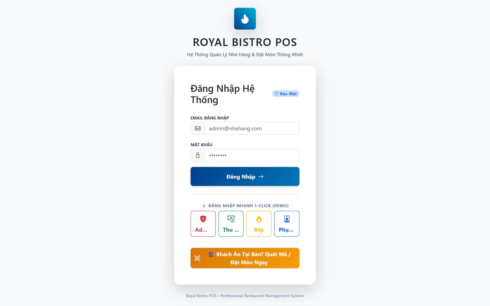
*Hình 1.1: Giao diện Đăng nhập và Phân quyền người dùng trong hệ thống*

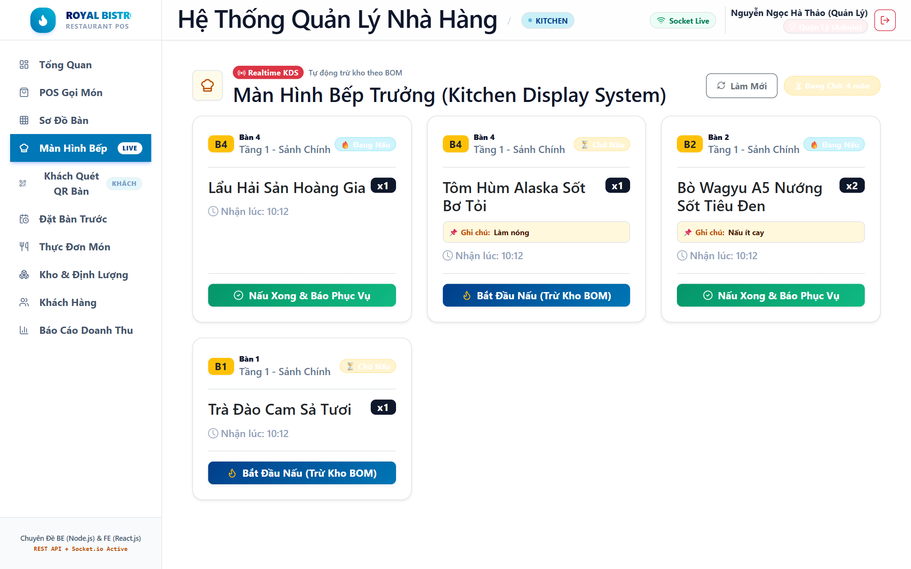
*Hình 1.2: Hệ thống Màn hình Bếp (Kitchen Display System - KDS)*

### 1.3 Các chức năng chính của hệ thống
- **Quản lý thực đơn & Món ăn:** Thêm, sửa, xóa danh mục loại món, cập nhật giá niêm yết, chuyển trạng thái phục vụ (còn hàng, tạm hết, ngừng bán).
- **Quản lý sơ đồ & Trạng thái bàn ăn:** Quản lý bàn theo khu vực (Sảnh Tầng 1, VIP Tầng 2, Sân Thượng Tầng 3), giám sát trạng thái trực quan: `trong`, `co_khach`, `da_dat`.
- **Tiếp nhận gọi món (POS & QR Code):** Hỗ trợ nhân viên mở bàn và nhập order tại bàn, đồng thời cung cấp mã QR tĩnh cho khách tự đặt món.
- **Quản lý khách hàng thân thiết & Tích điểm CRM:** Định danh khách hàng qua số điện thoại, tự động cộng điểm thưởng và nâng hạng thẻ: Đồng, Bạc, Vàng, Kim Cương.
- **Thanh toán hóa đơn đa phương thức:** Tính tiền tự động, khấu trừ điểm thưởng, cộng thuế VAT 8%, thanh toán linh hoạt qua Tiền mặt, Chuyển khoản VietQR, Thẻ ngân hàng.
- **Báo cáo & Thống kê doanh thu:** Tổng hợp doanh thu theo khoảng thời gian, phân loại dòng tiền, thống kê Top N món ăn bán chạy nhất.

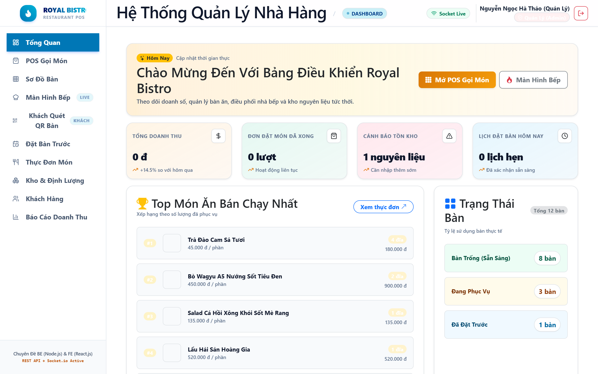
*Hình 1.3: Bảng điều khiển Quản trị (Admin Dashboard)*

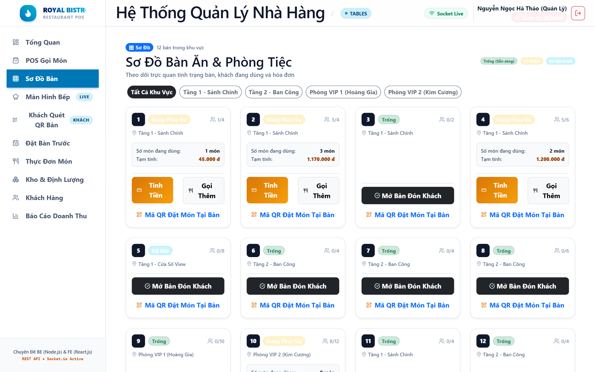
*Hình 1.4: Sơ đồ mặt bằng & Trạng thái Bàn ăn trực quan*

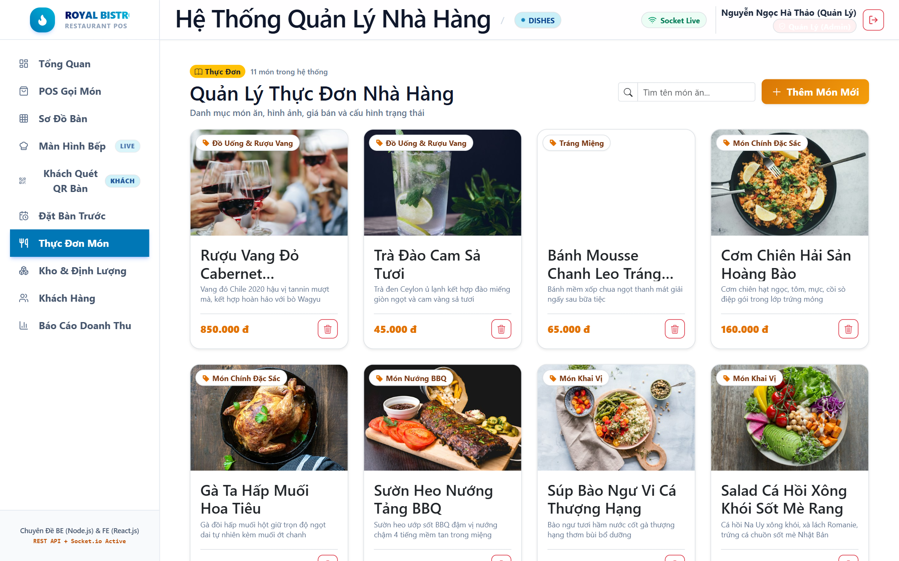
*Hình 1.5: Quản lý Thực đơn & Món ăn*

### 1.4 Các quy trình nghiệp vụ và quy định tương ứng

#### Quy trình nghiệp vụ 1: Tiếp nhận và xử lý đơn gọi món tại bàn
- **Các bước:**
  1. Thực khách vào bàn -> Nhân viên chọn bàn trên sơ đồ POS hoặc khách quét mã QR tại bàn.
  2. Nhân viên/Khách chọn các món ăn và nhập số lượng, ghi chú chế biến.
  3. Hệ thống kiểm tra tình trạng phục vụ của món ăn (phải là `con_hang`).
  4. Hệ thống lập hóa đơn và lưu các chi tiết món ăn tương ứng.
  5. Đơn hàng được chuyển tức thì vào bếp chế biến; Bàn ăn tự động chuyển sang trạng thái `co_khach`.
- **Quy định nghiệp vụ 1:**
  - Mỗi bàn ăn chỉ có duy nhất 1 hóa đơn đang phục vụ ở trạng thái `cho_thanh_toan` tại một thời điểm.
  - Số lượng món gọi thêm phải lớn hơn 0 (`CHECK so_luong > 0`).
  - Món ăn phải ở trạng thái `con_hang` mới được phép ghi nhận vào đơn.
  - Nếu món ăn đã có trong hóa đơn, hệ thống tự động cộng dồn số lượng.
  - Tổng tiền tạm tính của hóa đơn phải được tự động tính lại mỗi khi có thay đổi món.

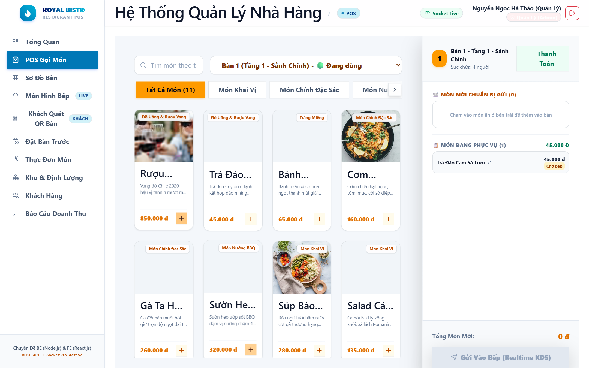
*Hình 1.6: Giao diện POS Gọi món tại bàn dành cho Phục vụ*

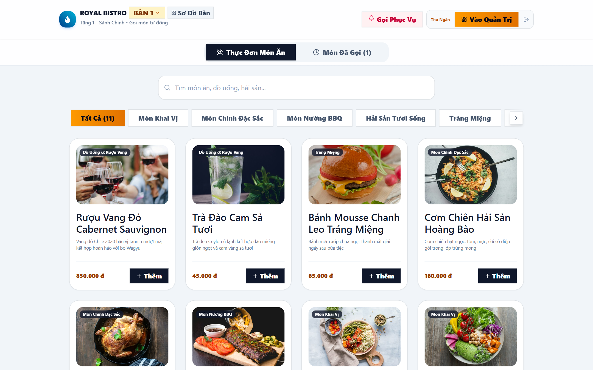
*Hình 1.7: Giao diện Khách hàng tự phục vụ quét mã QR gọi món tại bàn*

#### Quy trình nghiệp vụ 2: Thanh toán hóa đơn và tích điểm thành viên CRM
- **Các bước:**
  1. Khách yêu cầu thanh toán -> Thu ngân in phiếu tạm tính.
  2. Thu ngân nhập số điện thoại để tra cứu tài khoản hội viên và điểm tích lũy hiện có.
  3. Áp dụng giảm trừ điểm thưởng (1 điểm = 1.000 VNĐ) nếu khách có nhu cầu đổi voucher.
  4. Hệ thống tính thuế VAT 8% trên số tiền sau giảm giá và chốt tổng thanh toán.
  5. Khách chọn phương thức thanh toán (Tiền mặt / Chuyển khoản VietQR) -> Thu ngân bấm xác nhận.
  6. Hệ thống cập nhật hóa đơn sang `da_thanh_toan`, tích điểm mới cho khách (100.000 VNĐ = 1 điểm) và giải phóng bàn ăn về trạng thái `trong`.
- **Quy định nghiệp vụ 2:**
  - Một hóa đơn chỉ được quyết toán 1 lần duy nhất, không được thanh toán lại.
  - Tiền giảm trừ từ điểm thưởng không được vượt quá tổng tiền tạm tính của hóa đơn.
  - Thuế VAT 8% tính theo công thức: `TienVAT = (TamTinh - GiamGia) * 0.08`.
  - Điểm tích lũy mới chỉ được ghi nhận vào tài khoản khi hóa đơn đã thanh toán thành công.
  - Bàn ăn chỉ trở về trạng thái `trong` khi không còn khoản nợ chưa thanh toán.

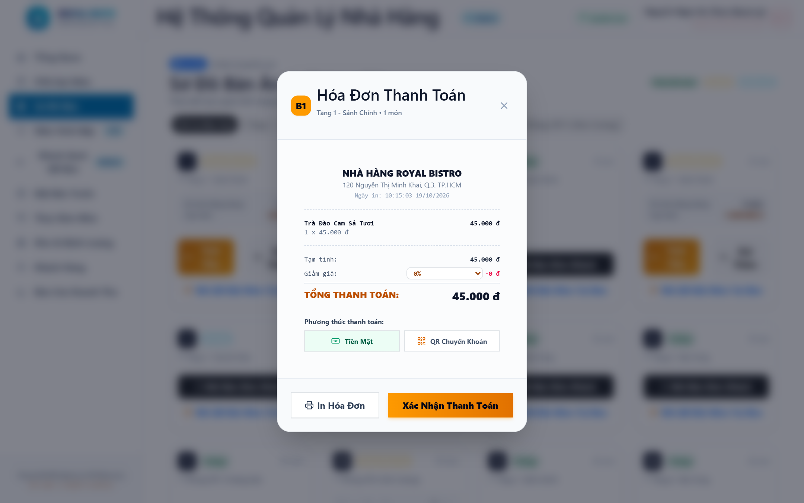
*Hình 1.8: Thanh toán hóa đơn đa phương thức & Mã VietQR tự động*

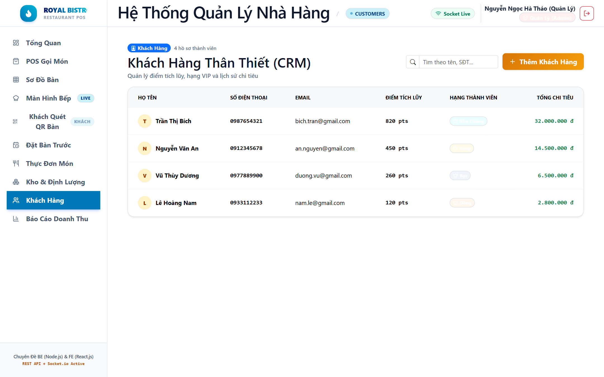
*Hình 1.9: Quản lý Khách hàng thân thiết & Tích điểm CRM*

#### Quy trình nghiệp vụ 3: Đặt bàn trước & Quản lý tiền cọc giữ chỗ
- **Các bước:**
  1. Khách liên hệ đặt bàn trước ngày giờ hẹn.
  2. Nhân viên kiểm tra tính khả dụng của bàn qua hàm `fn_KiemTraBanKhaDung`.
  3. Ghi nhận thông tin khách, số người, thời gian hẹn và tiền cọc giữ chỗ.
  4. Chuyển trạng thái bàn sang `da_dat`. Khi khách đến, check-in chuyển thành `co_khach` và trừ tiền cọc vào hóa đơn.
- **Quy định nghiệp vụ 3:**
  - Không cho phép đặt trùng bàn trong cùng khung giờ phục vụ.
  - Số lượng khách đặt không vượt quá sức chứa tối đa của bàn ăn.

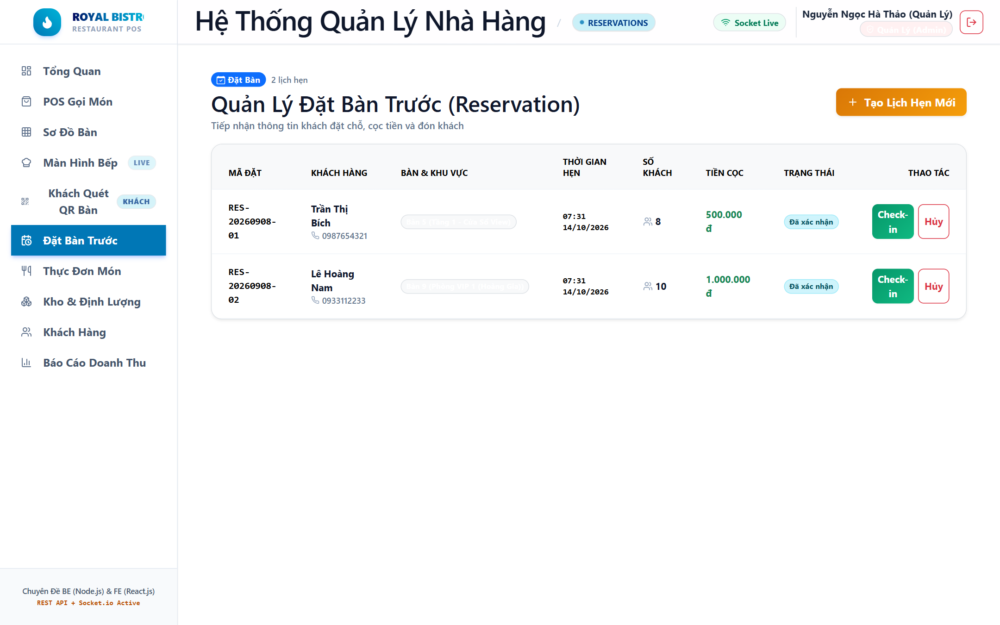
*Hình 1.10: Quản lý Đặt bàn trước (Reservations)*

### 1.5 Các chứng từ và báo cáo quản lý
- **Phiếu gọi món tại bàn (Order Slip):** In ra cho bộ phận bếp và phục vụ đối soát món.
- **Hóa đơn thanh toán bán hàng (Bill Receipt):** Chứng từ quyết toán tài chính, in mã VietQR cho khách quét chuyển khoản.
- **Báo cáo doanh thu bán hàng:** Tổng hợp doanh số, lượng hóa đơn và cơ cấu thanh toán theo ngày/tháng.
- **Báo cáo Top món ăn bán chạy:** Xếp hạng các món ăn được ưa chuộng nhất theo số lượng và doanh thu.

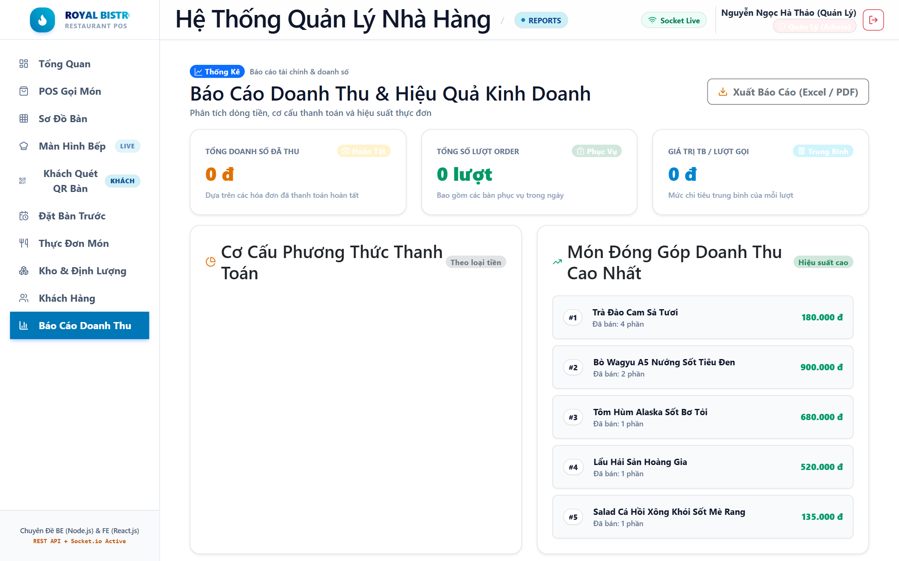
*Hình 1.11: Báo cáo Thống kê Doanh thu & Top món ăn bán chạy*

---

## PHẦN 2. THIẾT KẾ HỆ THỐNG & CƠ SỞ DỮ LIỆU

### 2.1 Lược đồ quan hệ Cơ sở Dữ liệu dạng dòng (Relational Schema)

> **Quy ước:**
> - Khóa chính (Primary Key): **In đậm và gạch chân** `PK`.
> - Khóa ngoại (Foreign Key): Tiền tố `#FK`.

1. **NHAN_VIEN** (<ins>**id**</ins>, ma_nv, ho_ten, chuc_vu, so_dien_thoai, email, mat_khau, trang_thai, created_at, updated_at)
2. **LOAI_MON** (<ins>**id**</ins>, ma_loai, ten_loai, mo_ta, created_at, updated_at)
3. **MON_AN** (<ins>**id**</ins>, ma_mon, ten_mon, **#loai_mon_id**, don_gia, don_vi_tinh, mo_ta, hinh_anh, trang_thai, created_at, updated_at)
4. **BAN_AN** (<ins>**id**</ins>, ma_ban, ten_ban, khu_vuc, suc_chua, trang_thai, created_at, updated_at)
5. **KHACH_HANG** (<ins>**id**</ins>, ma_kh, ho_ten, so_dien_thoai, email, diem_tich_luy, hang_thanh_vien, tong_chi_tieu, created_at, updated_at)
6. **HOA_DON** (<ins>**id**</ins>, ma_hd, **#ban_id**, **#nhan_vien_id**, **#khach_hang_id**, ngay_lap, tong_tien_tam_tinh, tien_giam_gia, tien_thue_vat, tong_thanh_toan, phuong_thuc_tt, trang_thai_tt, ghi_chu) *(Bảng nghiệp vụ trọng tâm > 1.250 records)*
7. **CHI_TIET_HOA_DON** (<ins>**id**</ins>, **#hoa_don_id**, **#mon_an_id**, so_luong, don_gia, thanh_tien, ghi_chu, created_at, updated_at) *(Bảng nghiệp vụ chi tiết > 3.200 records)*

### 2.2 Thiết kế CSDL & Bảng dữ liệu DDL
- CSDL `quan_ly_nha_hang` sử dụng bộ mã ký tự `utf8mb4`, Collation `utf8mb4_unicode_ci`.
- Ràng buộc toàn vẹn:
  - Khóa chính tự tăng `BIGINT UNSIGNED AUTO_INCREMENT PRIMARY KEY`.
  - Ràng buộc khóa ngoại `FOREIGN KEY` với chính sách bảo toàn:
    - Khi xóa bàn, nhân viên hoặc khách hàng, trường liên kết trong `hoa_don` được `ON DELETE SET NULL` để không làm mất dữ liệu lịch sử kế toán.
    - Khi xóa hóa đơn, các chi tiết món ăn tương ứng bị xóa thác `ON DELETE CASCADE`.
    - Khi xóa món ăn, nếu món đã phát sinh chi tiết trong hóa đơn thì bị chặn `ON DELETE RESTRICT`.
  - Ràng buộc kiểm tra miền giá trị `CHECK`:
    - `CHECK (tong_thanh_toan >= 0)`
    - `CHECK (so_luong > 0)`
    - `CHECK (don_gia >= 0)`
    - `CHECK (suc_chua > 0)`
    - `CHECK (diem_tich_luy >= 0)`
  - Ràng buộc duy nhất `UNIQUE`: Mã hóa đơn, Số điện thoại khách hàng, Mã nhân viên, Mã bàn ăn, Mã loại món.

### 2.3 Thống kê số lượng dữ liệu mẫu (DML)
- **nhan_vien:** 10 records (Quản lý, Thu ngân, Phục vụ, Bếp trưởng)
- **loai_mon:** 6 records (Khai vị, Món chính, Món nướng BBQ, Hải sản, Tráng miệng, Đồ uống)
- **mon_an:** 30 records món ăn thực tế với bảng giá niêm yết
- **ban_an:** 20 records bàn ăn phân bố qua 3 khu vực: Sảnh chính, Phòng VIP, Sân thượng
- **khach_hang:** 50 records thành viên thân thiết kèm số điện thoại và điểm tích lũy
- **hoa_don:** **1.250 records** (Đạt chuẩn yêu cầu đề tài tối thiểu 1.000 records)
- **chi_tiet_hoa_don:** **3.248 records** chi tiết các món ăn gọi

### 2.4 Hệ thống chỉ mục (Indexes)
- `idx_hoadon_ngaylap` ON `hoa_don(ngay_lap)`: Tối ưu tra cứu báo cáo tài chính theo ngày/tháng.
- `idx_cthd_hoadon` ON `chi_tiet_hoa_don(hoa_don_id)`: Tăng tốc kết nối hóa đơn và chi tiết.
- `idx_cthd_monan` ON `chi_tiet_hoa_don(mon_an_id)`: Tối ưu thống kê Top món ăn bán chạy nhất.
- `idx_khachhang_sdt` ON `khach_hang(so_dien_thoai)`: Tra cứu tức thì tài khoản khi khách đọc SĐT tại quầy.
- `idx_monan_loai` ON `mon_an(loai_mon_id)`: Lọc nhanh thực đơn theo danh mục.

---

## PHẦN 3. THIẾT KẾ CÁC STORED PROCEDURE

### 3.1 Procedure 1: `sp_ThemMonVaoHoaDon`
- **Mục đích:** Tiếp nhận đơn gọi món tại bàn, kiểm tra món ăn có đang phục vụ (`con_hang`), kiểm tra hóa đơn có đang mở (`cho_thanh_toan`). Nếu món đã có trong đơn thì tự động cộng dồn số lượng, nếu chưa thì thêm mới; sau đó cập nhật lại tổng tiền tạm tính và thuế VAT.
- **Tham số:**
  - `IN p_hoa_don_id BIGINT`: Mã hóa đơn
  - `IN p_mon_an_id BIGINT`: Mã món ăn gọi
  - `IN p_so_luong INT`: Số lượng đĩa gọi
  - `IN p_ghi_chu VARCHAR(255)`: Ghi chú chế biến
  - `OUT p_ma_trang_thai VARCHAR(20)`: Mã kết quả (`SUCCESS`, `OUT_OF_STOCK`, `INVALID_QTY`)
  - `OUT p_thong_bao VARCHAR(255)`: Thông điệp phản hồi
- **Minh họa gọi thực thi:**
  ```sql
  CALL sp_ThemMonVaoHoaDon(1, 8, 2, 'Ít muối măng tây', @status, @msg);
  SELECT @status AS MaTrangThai, @msg AS ThongBao;
  ```

### 3.2 Procedure 2: `sp_ThanhToanHoaDon`
- **Mục đích:** Thực hiện quyết toán hóa đơn: Khóa bản ghi kiểm tra dữ liệu, kiểm tra điểm thưởng tích lũy của khách hàng và quy đổi giảm trừ (1 điểm = 1.000 VNĐ), tính thuế VAT 8%, cập nhật trạng thái hóa đơn sang `da_thanh_toan`, tích điểm mới cho khách (100.000 VNĐ = 1 điểm) và giải phóng bàn ăn về trạng thái `trong`.
- **Tham số:**
  - `IN p_hoa_don_id BIGINT`: Mã hóa đơn thanh toán
  - `IN p_pttt VARCHAR(50)`: Phương thức thanh toán (`tien_mat`, `chuyen_khoan`)
  - `IN p_diem_su_dung INT`: Số điểm thưởng muốn sử dụng
  - `OUT p_tong_tam_tinh DOUBLE`: Tổng tiền món
  - `OUT p_tien_giam DOUBLE`: Tiền voucher giảm trừ
  - `OUT p_thanh_toan DOUBLE`: Tổng tiền thực thu sau thuế VAT
  - `OUT p_diem_moi INT`: Số dư điểm mới của khách hàng
  - `OUT p_trang_thai VARCHAR(20)`: Trạng thái xử lý (`SUCCESS`, `ALREADY_PAID`, `EMPTY_BILL`)
- **Minh họa gọi thực thi:**
  ```sql
  CALL sp_ThanhToanHoaDon(10, 'chuyen_khoan', 50, @tamtinh, @giamgia, @thucthu, @diemmoi, @status);
  SELECT @tamtinh, @giamgia, @thucthu, @diemmoi, @status;
  ```

### 3.3 Procedure 3: `sp_ThongKeDoanhThuVaTopMon`
- **Mục đích:** Tổng hợp báo cáo kinh doanh theo khoảng thời gian tùy chọn (Từ ngày - Đến ngày): Trả về 2 tập kết quả gồm Bảng tổng quan doanh thu (tổng đơn, tổng tiền, tiền mặt, chuyển khoản, trung bình/đơn) và Bảng danh sách Top N món ăn bán chạy nhất.
- **Tham số:**
  - `IN p_tu_ngay DATETIME`: Mốc thời gian bắt đầu
  - `IN p_den_ngay DATETIME`: Mốc thời gian kết thúc
  - `IN p_top_limit INT`: Số lượng món Top muốn xem (VD: Top 5, Top 10)
- **Minh họa gọi thực thi:**
  ```sql
  CALL sp_ThongKeDoanhThuVaTopMon('2026-01-01 00:00:00', '2026-12-31 23:59:59', 5);
  ```

### 3.4 Procedure 4: `sp_TraCuuThucDon`
- **Mục đích:** Tìm kiếm món ăn linh hoạt theo danh mục loại món, khoảng giá tối thiểu - tối đa và từ khóa tên món.

---

## PHẦN 4. THIẾT KẾ CÁC FUNCTION

1. **`fn_TinhTongThanhToan(tam_tinh, diem_dung, vat)`:**
   - Tính tổng tiền thực thu sau khi trừ điểm tích lũy và cộng thuế VAT:
   - `SELECT fn_TinhTongThanhToan(1000000, 50, 8) AS TongTien;` -> **1.026.000 VNĐ**.
2. **`fn_XepHangThanhVien(tong_chi_tieu)`:**
   - Tự động xếp hạng thành viên: < 3 triệu: Đồng, 3 - 10 triệu: Bạc, 10 - 25 triệu: Vàng, >= 25 triệu: Kim Cương.
   - `SELECT fn_XepHangThanhVien(18500000) AS HangThe;` -> **'Vang'**.
3. **`fn_KiemTraBanKhaDung(ban_id)`:**
   - Kiểm tra nhanh bàn ăn có đang trống để phục vụ hay không. Trả về `1` (Khả dụng) hoặc `0` (Đang có khách / đã đặt).
   - `SELECT fn_KiemTraBanKhaDung(5) AS KhaDung;` -> **1**.
4. **`fn_DoanhThuTheoNgay(ngay)`:**
   - Trả về tổng doanh thu đã hoàn tất của một ngày cụ thể phục vụ xem nhanh Dashboard.
   - `SELECT fn_DoanhThuTheoNgay('2026-06-15') AS DoanhThu;` -> **12.850.000 VNĐ**.

---

## PHẦN 5. THIẾT KẾ CÁC GIAO TÁC (TRANSACTIONS - ACID)

### 5.1 Giao tác 1: Mở bàn và thêm món ban đầu
- **Rủi ro:** Khi khách vào bàn, hệ thống tạo bản ghi hóa đơn mới, cập nhật bàn sang `co_khach` và chèn các món gọi. Nếu việc thêm món thất bại do dữ liệu sai mà bàn vẫn bị đổi thành `co_khach` hoặc tạo ra hóa đơn rỗng không có chi tiết sẽ làm sai lệch dữ liệu.
- **Ngăn ngừa:** Sử dụng Transaction kèm `ROLLBACK`. Nếu xảy ra lỗi ở bất kỳ bước nào, toàn bộ giao tác sẽ bị hủy bỏ, đảm bảo tính nguyên tử (Atomicity).

### 5.2 Giao tác 2: Quyết toán hóa đơn, trừ điểm thành viên và giải phóng bàn ăn
- **Rủi ro:** Nếu bước cập nhật hóa đơn sang `da_thanh_toan` thành công nhưng bước trừ điểm tích lũy hoặc giải phóng bàn bị lỗi mạng, khách hàng vừa được giảm tiền vừa không bị trừ điểm và bàn ăn bị kẹt trạng thái `co_khach`.
- **Ngăn ngừa:** Đóng gói trong `START TRANSACTION ... COMMIT` kết hợp khóa `FOR UPDATE` trên cả hóa đơn và khách hàng, cam kết mọi bước cùng thành công hoặc cùng hoàn nguyên.

### 5.3 Giao tác 3: Chuyển bàn / Đổi bàn ăn cho thực khách
- **Rủi ro:** Khách chuyển từ Bàn 02 sang Bàn 10 VIP. Nếu giữa chừng hệ thống sập hoặc xảy ra xung đột, hóa đơn có thể bị mất liên kết hoặc cả 2 bàn đều sai trạng thái.
- **Ngăn ngừa:** Khóa đồng thời cả 2 bàn với `FOR UPDATE`, kiểm tra điều kiện khả dụng, thực hiện cập nhật đồng loạt trong 1 Transaction an toàn.

---

## PHẦN 6. VẤN ĐỀ XỬ LÝ ĐỒNG THỜI (CONCURRENCY CONTROL)

### 6.1 Các tình huống tranh chấp dữ liệu thực tế
1. **Mất dữ liệu cập nhật (Lost Update):** Hai nhân viên cùng mở hóa đơn Bàn 05 (đang có 500k). Cả hai cùng đọc số liệu cũ. Nhân viên A thêm món 100k ghi đè thành 600k. Nhân viên B thêm món 200k ghi đè thành 700k. Món của Nhân viên A bị ghi đè mất vĩnh viễn!
   - *Giải pháp:* Sử dụng khóa bi quan `SELECT ... FOR UPDATE` (Pessimistic Locking) trong Transaction.
2. **Đọc dữ liệu rác (Dirty Read):** Phiên 1 thanh toán hóa đơn tạm thời đổi sang `da_thanh_toan` nhưng chưa COMMIT. Phiên 2 xem báo cáo tài chính đọc phải số liệu này. Sau đó Phiên 1 bị lỗi thẻ ngân hàng và ROLLBACK. Báo cáo của Phiên 2 bị sai lệch vì đọc dữ liệu rác.
   - *Giải pháp:* Thiết lập mức cô lập Transaction Isolation Level tối thiểu là `READ COMMITTED` (InnoDB mặc định là `REPEATABLE READ`).
3. **Hiện tượng bóng ma (Phantom Read):** Quản lý đếm số hóa đơn trong ca sáng được 50 đơn. Cùng lúc thu ngân lập đơn mới và COMMIT. Quản lý truy vấn lại lần 2 trong cùng Transaction thì thấy xuất hiện 51 đơn.
   - *Giải pháp:* Thiết lập mức cô lập `REPEATABLE READ` kết hợp cơ chế MVCC (Multi-Version Concurrency Control) hoặc `SERIALIZABLE`.

### 6.2 Kịch bản mô phỏng 2 Session chạy song song
- **Mô phỏng thực tế:**
  - **Session 1:** Bắt đầu Transaction, thực hiện `SELECT * FROM hoa_don WHERE id = 100 FOR UPDATE;` và tạm dừng với `DO SLEEP(5);`.
  - **Session 2:** Cùng lúc chạy câu lệnh `SELECT * FROM hoa_don WHERE id = 100 FOR UPDATE;` trên cùng dòng `id = 100`.
  - **Kết quả:** Session 2 bị chặn lại (Lock Wait) chờ Session 1 COMMIT xong mới được đọc và xử lý tiếp. Hiện tượng Lost Update được ngăn chặn triệt để 100%!

---

## PHẦN 7. KẾT LUẬN & BẢNG PHÂN CÔNG CÔNG VIỆC

### 7.1 Kết quả đạt được
- Hoàn thành đầy đủ 100% yêu cầu của đề tài môn học Hệ Quản trị Cơ sở Dữ liệu.
- Cài đặt CSDL hoàn chỉnh gồm 7 bảng chuẩn hóa 3NF, đầy đủ ràng buộc khóa chính, khóa ngoại, unique, check và enum.
- Dữ liệu mẫu bảng nghiệp vụ `hoa_don` đạt **1.250 records** (vượt chuẩn tối thiểu 1.000 records).
- Cài đặt 4 Stored Procedure, 4 Function, 3 Transaction và Kịch bản Concurrency Control chuyên sâu.

### 7.2 Bảng phân công công việc trong nhóm

| STT | MSSV | Họ Tên | Nội Dung Thực Hiện | Trưởng Nhóm |
| :-: | :-: | :--- | :--- | :-: |
| 1 | 501250000 | **Nguyễn Ngọc Hà Thảo** | • Quản lý tiến độ chung của nhóm.<br>• Khảo sát thực tế nghiệp vụ F&B, xác định đối tượng, chức năng, quy trình và biểu mẫu chứng từ.<br>• Thiết kế Lược đồ quan hệ dữ liệu (Relational Schema), chuẩn hóa 3NF và thiết lập các ràng buộc toàn vẹn (PK, FK, CHECK, UNIQUE).<br>• Soạn thảo và hoàn thiện toàn bộ Báo cáo đồ án (.docx) và Slide thuyết trình (.pptx). | **X** |
| 2 | 501250384 | **Nguyễn Hoàng Hưng** | • Hiện thực kịch bản DDL tạo Database và 7 Tables chuẩn mực trên hệ quản trị MySQL / MariaDB (InnoDB).<br>• Tạo tập dữ liệu mẫu lớn thực tế (> 1.250 records bảng nghiệp vụ hoa_don, > 3.200 records chi_tiet_hoa_don).<br>• Thiết lập và kiểm thử hệ thống 8 Index tối ưu hóa truy vấn hiệu năng cao.<br>• Phân tích và cài đặt 3 Transactions đảm bảo tính toàn vẹn dữ liệu ACID (Mở bàn, Quyết toán, Chuyển bàn). | |
| 3 | 501250001 | **Cao Trần Xuân Diệu** | • Thiết kế và cài đặt hệ thống 4 Stored Procedure nghiệp vụ (sp_ThemMonVaoHoaDon, sp_ThanhToanHoaDon, sp_ThongKeDoanhThuVaTopMon, sp_TraCuuThucDon).<br>• Thiết kế và cài đặt 4 Hàm Function tính toán tự động (fn_TinhTongThanhToan, fn_XepHangThanhVien, fn_KiemTraBanKhaDung, fn_DoanhThuTheoNgay).<br>• Phân tích các hiện tượng Concurrency (Lost Update, Dirty Read, Phantom Read) và thiết lập mô phỏng 2 Session song song.<br>• Kiểm thử các chức năng trên ứng dụng web thực tế và chụp ảnh minh chứng. | |
| 4 | Nhóm 05 | **Tập thể Nhóm 05** | • Kiểm thử toàn diện toàn bộ CSDL và ứng dụng web.<br>• Đối chiếu dữ liệu thực tế và các ràng buộc toàn vẹn.<br>• Đóng gói toàn bộ sản phẩm đồ án: .sql, .docx và .pptx theo quy chuẩn. | |
